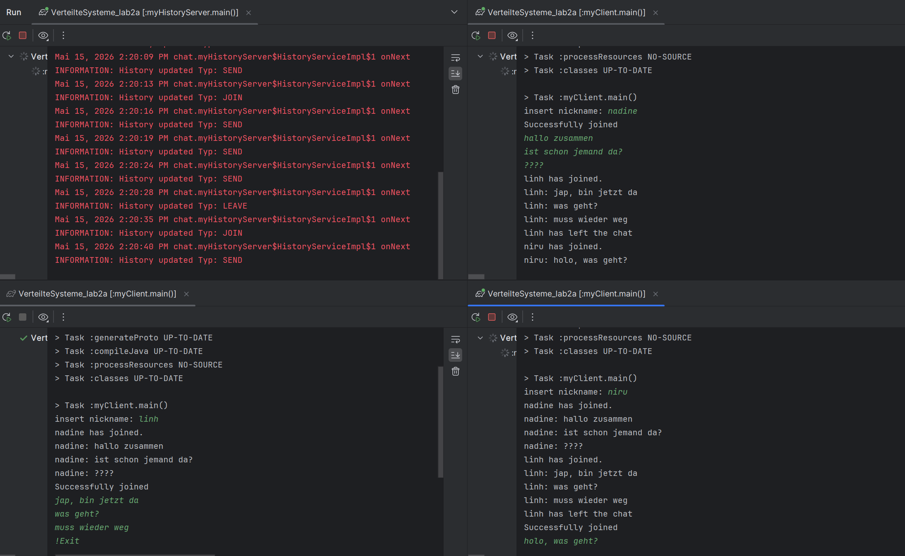

# Lab 02 - gRPC Chat Application & Service Chaining

A chat application built on a **service-oriented architecture (SOA)** using **gRPC** and **Protocol Buffers (proto3)**. It consists of a main chat server, multiple clients, and an independent history server that receives a mirrored copy of the chat via a second gRPC stream (**service chaining**).

## What the Project Does

- **Classic chat:**
  - Registration of 2 < N <= 10 participants via nickname with duplicate handling (`NAME_TAKEN`, `CHAT_FULL`).
  - Sending and receiving messages to all active participants, plus querying the current member list.
  - Uses gRPC **bidirectional streaming** (`RegisterStream`) and `oneof` syntax (`MemberOptions`).
- **Service chaining / history server:**
  - An independent **history server** runs as an additional service.
  - The main server mirrors every chat event to the history server over a gRPC stream (`RegisterChat`).
  - New clients receive the existing chat history directly upon joining.
- **Byte-level analysis:** Transmitted gRPC messages can be analyzed at the byte level (hex decoding of protobuf string/int fields) using **Wireshark**.

## Project Structure

```text
project2/
├── .gitignore                  # Ignores build/, .gradle/, .idea/
├── .idea/                      # IntelliJ IDEA project configuration
├── assets/                     # Screenshots (see below)
├── build.gradle.kts            # Java + protobuf-gradle-plugin, gRPC dependencies
├── settings.gradle.kts
├── gradle/wrapper/             # Gradle wrapper jar + properties
├── gradlew / gradlew.bat       # Gradle wrapper (8.14.3)
├── README.md
└── src/main/
    ├── proto/
    │   ├── chat.proto          # ChatService & HistoryService definitions
    │   └── hello.proto         # Greeter service (starter example)
    └── java/
        ├── chat/
        │   ├── myServer.java         # Main chat server (port 50051), mirrors to history
        │   ├── myClient.java         # Chat client with join loop and !List / !Exit commands
        │   └── myHistoryServer.java  # History server (port 50052), stores chat events
        └── org/example/
            ├── HelloWorldClient.java # Minimal gRPC example client
            ├── HelloWorldServer.java # Minimal gRPC example server
            └── Main.java             # Starter entry point
```

**Architecture:**

| Component      | Proto service   | Port  | Role                                              |
| -------------- | --------------- | ----- | ------------------------------------------------- |
| Chat server    | `ChatService`   | 50051 | Registration, broadcast, member list              |
| History server | `HistoryService`| 50052 | Stores and replays the chat history               |
| Client         | `ChatService`   | -     | Joins, sends messages, receives broadcasts        |

## Requirements

- Java 11+ (project targets `JavaVersion.VERSION_11`)
- Gradle wrapper is included (`gradlew`), protobuf/gRPC plugins are declared in `build.gradle.kts`
- Optional: Wireshark for byte-level analysis

## Build & Run

### 1. Build (generates gRPC stubs from the `.proto` files and compiles)

```powershell
.\gradlew.bat build
```

### 2. Start the services (in this order)

The main classes have hardcoded ports and addresses:

| Order | Main class                  | Listens / connects                     |
| ----- | --------------------------- | -------------------------------------- |
| 1     | `chat.myHistoryServer`      | listens on `localhost:50052`           |
| 2     | `chat.myServer`             | listens on `50051`, connects to `50052`|
| 3     | `chat.myClient` (multiple)  | connects to `localhost:50051`          |

Run each class from your IDE (IntelliJ run configurations) or from the command line with the project classpath, e.g.:

```powershell
java -cp "build\classes\java\main;<dependencies>" chat.myHistoryServer
```

> Tip: Using IntelliJ IDEA is recommended - the `.idea` configuration is included and the gRPC/protobuf sources are generated on build.

### 3. Play

- Start the history server, then the chat server, then multiple clients.
- On a client, enter a nickname to join. Open a second client to chat between participants.
- Client commands:
  - `!List` - print the current list of active members.
  - `!Exit` - leave the chat and close the connection.

## Screenshots


